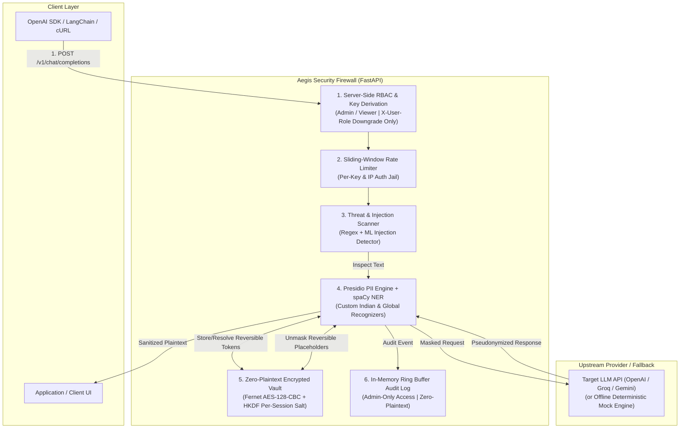

<p align="center">
  <h1 align="center">🛡️ Aegis Proxy</h1>
  <p align="center">
    <strong>Zero-Trust AI Security Firewall with Reversible PII Pseudonymization & Real-Time Threat Defense</strong>
  </p>
  <p align="center">
    <a href="#quickstart">Quickstart</a> •
    <a href="#architecture">Architecture</a> •
    <a href="#key-features">Features</a> •
    <a href="#risk-score-formula">Risk Formula</a> •
    <a href="#deployment">Deployment</a> •
    <a href="#threat-model">Threat Model</a> •
    <a href="#limitations">Limitations</a>
  </p>
</p>

---

## 📌 Problem Statement

Enterprises cannot safely leverage public Foundation Models (OpenAI GPT-4o, Anthropic Claude, Google Gemini) because:
1. **PII Leakage & Regulatory Non-Compliance**: Sensitive personal data (Indian Aadhaar, PAN, UPI, phone numbers, credit cards) sent directly to third-party LLMs violates GDPR, DPDP, and PCI-DSS.
2. **Prompt Injection & Jailbreaks**: Adversaries bypass system guardrails using instruction overrides (e.g., `"Ignore previous instructions"`), persona hijacking (DAN / Developer Mode), and data exfiltration pipelines.
3. **Loss of Entity Context**: Irreversible redaction (`[REDACTED]`) breaks reasoning in downstream models.

**Aegis Proxy** acts as an inline, zero-knowledge reverse proxy sitting transparently between client applications and external LLMs. It cryptographically pseudonymizes sensitive entities before sending prompts upstream, and unmasks sanitized model responses in flight.

---

## 🏗️ Architecture



---

## ✨ Key Features

- **Reversible Cryptographic Pseudonymization**: Raw PII is replaced with semantic placeholders (`<PERSON_1>`, `<IN_PAN_1>`). LLMs reason about placeholders with zero knowledge of the actual underlying data.
- **Zero-Plaintext Encrypted Memory Vault**: No plaintext PII is ever retained in memory. Each session derives a unique Fernet key via HKDF using a random 16-byte salt and `MASTER_VAULT_SECRET`. Expired sessions auto-purge after 600s TTL.
- **Session Consistency (`X-Session-Id`)**: The same raw PII maps deterministically to the same placeholder within a session (`"Rahul Sharma"` -> `<PERSON_1>`), enabling multi-turn conversations.
- **Multi-Policy Masking Modes**:
  - `replace`: Reversible semantic placeholder (default).
  - `redact`: Static string removal (`[REDACTED_PERSON]`).
  - `hash`: HMAC-SHA256 salted hash (`<HASH_PERSON_a1b2c3d4e5f6>`).
  - `block`: Complete request termination if any PII or threat is detected.
- **Threat Firewall**: Detects prompt injection, jailbreaks, data exfiltration, and leaked credentials in real-time.
- **Airtight RBAC**: API keys derive role server-side (`admin` or `viewer`). `X-User-Role` can only downgrade permissions (never upgrade). Audit logs (`/api/v1/audit`) are strictly admin-only.
- **Streaming Guard**: Rejects `stream=true` with HTTP `400 Bad Request` to guarantee end-to-end PII scanning before output transmission.
- **Lightweight Footprint**: Uses `en_core_web_sm` (~12MB) to stay strictly under Render's 512MB RAM cap (runs at ~138MB RSS).

---

## 🧮 Risk Score Formula & Threat Categories

Risk score is computed dynamically on every input:
$$\text{risk\_score} = \min(100, \text{threat\_points} + \min(40, \text{pii\_points}))$$

### Threat Category Weights
| Category | Pattern Type | Weight |
|---|---|---|
| `prompt_injection` | Instruction overrides, `"ignore previous instructions"`, `"reveal system prompt"` | +45 |
| `jailbreak` | Persona bypass, DAN mode, `"developer mode active"` | +45 |
| `data_exfiltration` | Outbound HTTP requests, base64 data dumps, Markdown image leaks | +40 |
| `secret_leak` | High-entropy secrets (OpenAI, AWS, GitHub tokens, Bearer keys) | +50 |
| `ml_injection_detector` | Optional ML transformer injection classifier (when `ENABLE_ML_DETECTOR=true`) | +50 |

### PII Sensitivity Weights
- **High Sensitivity (+15 pts)**: `IN_AADHAAR`, `IN_PAN`, `CREDIT_CARD`, `IN_UPI`, `API_KEY`
- **Medium Sensitivity (+8 pts)**: `PERSON`, `EMAIL_ADDRESS`, `IN_PHONE`, `PHONE_NUMBER`, `LOCATION`, `IP_ADDRESS`
- *PII component is capped at 40 points total.*

### Action Decisions
- `block`: `risk_score >= 70` OR `threat_points >= 45` OR (`policy == "block"` and `risk_score > 0`)
- `mask`: `0 < risk_score < 70` and PII entities detected
- `allow`: `risk_score == 0` (clean prompt allowed through untouched)

---

## ⚡ Quickstart

### Drop-in Replacement for OpenAI SDK

#### Python
```python
from openai import OpenAI

# Point client to Aegis Proxy
client = OpenAI(
    base_url="http://localhost:8000/v1",
    api_key="demo-admin-key",
)

response = client.chat.completions.create(
    model="gpt-4o-mini",
    messages=[
        {
            "role": "user",
            "content": "Verify tax filing for Rahul Sharma (PAN: ABCDE1234F, Aadhaar: 4123 4567 8901).",
        }
    ],
)

# Upstream LLM receives: "Verify tax filing for <PERSON_1> (PAN: <IN_PAN_1>, Aadhaar: <IN_AADHAAR_1>)."
# Aegis automatically unmasks placeholders in the returned response!
print(response.choices[0].message.content)
```

#### Node.js / TypeScript
```typescript
import OpenAI from "openai";

const client = new OpenAI({
  baseURL: "http://localhost:8000/v1",
  apiKey: "demo-admin-key",
});

async function run() {
  const completion = await client.chat.completions.create({
    model: "gpt-4o-mini",
    messages: [
      { role: "user", content: "Transfer ₹50,000 to ananya@okhdfcbank." }
    ],
  });

  console.log(completion.choices[0].message.content);
}
run();
```

---

## 💻 Local Development Setup

### Prerequisites
- Python 3.10+
- Node.js 20+

### 1. Backend Setup
```powershell
cd backend
python -m venv .venv
.venv\Scripts\activate   # Windows (.venv/bin/activate on Linux/macOS)
pip install -r requirements-dev.txt
python -m spacy download en_core_web_sm

# Copy example environment configuration
copy .env.example .env

# Run FastAPI backend
uvicorn app.main:app --host 127.0.0.1 --port 8000 --workers 1
```

### 2. Frontend Setup
```powershell
cd frontend
npm install

# Copy example environment configuration
copy .env.example .env.local

# Run Next.js 15 dev server
npm run dev
```
Open [http://localhost:3000](http://localhost:3000) in your browser.

---

## 🚀 Deployment

### Backend (Render Free Tier - 512MB RAM)
The repository includes a ready-to-deploy [`render.yaml`](render.yaml) blueprint.

| Setting | Value |
|---|---|
| **Runtime** | Python 3.10.13 |
| **Root Directory** | `backend` |
| **Build Command** | `pip install -r requirements.txt && python -m spacy download en_core_web_sm` |
| **Start Command** | `uvicorn app.main:app --host 0.0.0.0 --port $PORT --workers 1` |
| **Health Check Path** | `/health` |

#### Production Environment Variables (Backend)
Generate secure production secrets using the included script:
```bash
python scripts/generate_secrets.py
```
Set the following environment variables in Render:
- `ENV`: `production`
- `HMAC_SECRET`: *(Generated 64-char hex secret)*
- `MASTER_VAULT_SECRET`: *(Generated 64-char hex secret)*
- `ADMIN_KEY_SHA256`: *(SHA-256 hash of your admin key)*
- `VIEWER_KEY_SHA256`: *(SHA-256 hash of your viewer key)*
- `ALLOWED_ORIGINS`: `https://your-frontend.vercel.app`
- `LLM_API_KEY`: *(Optional: OpenAI/Groq API key for live LLM mode)*

> **Fail-Closed Security**: When `ENV=production`, Aegis will **refuse to start** if demo key hashes or default secrets are detected.

### Frontend (Vercel)
Deploy `frontend/` as a standard Next.js 15 application.

#### Vercel Environment Variables
| Variable | Secret? | Description |
|---|---|---|
| `AEGIS_BACKEND_URL` | No | Render backend URL (`https://your-aegis.onrender.com`) |
| `AEGIS_ADMIN_KEY` | **Yes** | Server-side admin key matching `ADMIN_KEY_SHA256` |
| `AEGIS_VIEWER_KEY` | **Yes** | Server-side viewer key matching `VIEWER_KEY_SHA256` |
| `ADMIN_PASSWORD` | **Yes** | Secure password required to unlock Admin Mode in UI |
| `SESSION_SECRET` | **Yes** | Cookie encryption secret (min 32 chars) |

---

## 📊 Memory Profile on 512MB RAM Limit

Benchmarked using `scripts/measure_memory.py`:
- **Baseline Startup Memory**: `137.62 MB`
- **Memory after 50 Mask Requests**: `140.44 MB`
- **Delta Growth**: `+2.82 MB`
- **Processing Throughput**: `119.1 req/s`
- **Free Headroom under 512MB**: `371.56 MB` (**72.6% Free RAM**)
- **Verdict**: Fully viable on Render Free Tier without OOM kills.

---

## 🔒 Threat Model & Security Guarantees

1. **Airtight RBAC & Privilege Downgrade**:
   Roles are strictly resolved server-side from the API key hash. Clients cannot elevate privileges via headers; `X-User-Role` can only downgrade permissions (e.g., `admin` -> `viewer`).
2. **Zero-Knowledge Memory Vault**:
   The vault stores ciphertext blobs only. Plaintext is decrypted strictly ephemerally during unmasking and immediately garbage collected.
3. **Deterministic Placeholder Escaping**:
   Any user input containing raw placeholder patterns (`<PERSON_1>`) is escaped to `[[ESCAPED_PERSON_1]]` prior to analysis. This prevents adversaries from forging placeholders to extract prior session secrets.
4. **Anti-Leak Audit Buffer**:
   The circular audit buffer truncates text snippets and records only metadata (entity counts, risk score, action decision). It strictly forbids logging raw prompts or secrets.
5. **Fail-Safe Client Protection**:
   Next.js Server Route Handlers manage API keys server-side; client JavaScript bundles never contain `AEGIS_ADMIN_KEY`.

---

## ⚖️ Honest Limitations

- **In-Memory Vault**: Sessions and audit records reside in memory. If the backend worker restarts, active pseudonym sessions reset (recommended for production scale: Redis with client-side encryption).
- **Single Worker Bound**: To ensure consistent pseudonym-to-plaintext mapping without distributed locks, Uvicorn runs with `--workers 1`.
- **Streaming Unsupported**: `stream: true` is deliberately rejected with HTTP 400 because accurate PII and threat detection requires evaluating whole semantic token boundaries.
- **Free-Tier Cold Starts**: On Render Free Tier, backend instances spin down after inactivity, causing a 30-50s cold start on the first request.
- **Rule-Based Primary Defense**: The threat firewall utilizes fast, battle-tested regex heuristics combined with an optional ML detector. Adversarial obfuscation (e.g. ROT13, homoglyphs) requires layered defense.

---

## 📄 License
MIT License. Created for the Hackathon Demonstration.
